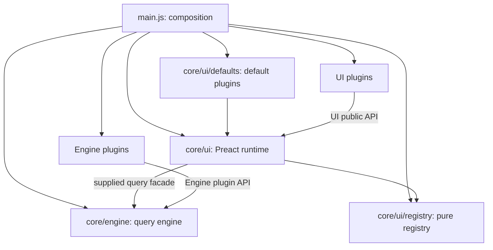

# Architecture

Pihka publishes SQLite data on a static host. The browser downloads the database
or reads it through the optional HTTP VFS, then queries it locally. There is no
backend, build step, CDN, or package installation at deployment time.

## Ownership and dependencies



- **Engine:** SQL, datasource lifecycle, structural schema, FK display-value
  lookup, relationships, filters, facet bounds/counts, and FTS. No UI, DOM,
  routes, preferences, widget names, or app-specific imports.
- **UI registry:** instance-owned component and codec definitions, with no
  framework or engine dependency.
- **UI runtime:** Preact mounting, guarded component dispatch, routing, query
  hooks, preferences, and presentation overlays. It imports no concrete plugins.
- **Default UI:** ordinary registered shell, pages, controls, views, cells and
  facets. Optional modules use the same API and can override defaults.
- **Composition:** `main.js` alone joins engine, UI and default implementations.
  `bootstrap.js` loads configuration/plugins and translates app settings into
  engine settings. Neither subsystem imports composition.

Replacing Preact means replacing its runtime and renderers. Engine contracts and
engine plugins survive unchanged. The registry does not make Preact components
portable to other frameworks. Browser APIs remain a deliberate engine platform
dependency; this is not a promise that SQLite WASM runs in Node or QuickJS.

`npm run test:engine` verifies import edges, missing imports, cycles, registry
isolation and engine contracts. UI plugins import `core/ui/index.js`, never
another plugin's implementation. Vendored code is outside these authored-code
checks and remains local to its owner.

## Opening a dataset without UI

```js
import { openDataset } from "./core/engine/index.js";

const session = await openDataset({
    databaseUrl: new URL("./app/database/sample.db", import.meta.url).href,
    config: { enrichment: { fts: "trigram" } },
    onProgress: ({ phase, bytes }) => console.log(phase, bytes),
});
try {
    const result = await session.store.queryTable("works", {
        filters: { author_id: { type: "multi", selected: [1, 2] } },
        sort: { column: "title", direction: "ASC" },
        page: 0,
        pageSize: 25,
    });
    console.log(result.rows, result.totalRows);
} finally {
    await session.close();
}
```

`openDataset({databaseUrl, config, plugins, onProgress})` returns
`{store, schema, close}`. Plugin arguments are imported modules, not paths.
Datasource defaults to `download`; its implementation is loaded only when
selected. HTTP VFS is installed by passing its module in `plugins` and setting
`config.datasource.type` to `http-vfs`. No Preact import map is needed by engine
consumers.

Normalized engine configuration contains `datasource`, `enrichment`,
`perspectives: [{id, table, query}]`, and
`columns: {table: {column: {numeric, noFts}}}`. App `type: "number"` and
`fts: false` settings translate to these hints. Labels, hidden flags, renderer
names and widget choices never enter the engine. Recognized FTS relations are
marked `internal`, separately from UI visibility.

The store exposes `getSchema`, `getFtsInfo`, `getFilterMeta`, `queryTable`,
`queryRow`, `queryRelated`, `resolveForeignKeys`, `queryFacetCounts`, and
`getFacetMeta`. Query operations are asynchronous; schema and FTS reads are
synchronous. `getFacetMeta` accepts semantic `range` or `values` requests.
`capabilities.filters` lists installed filter names and `capabilities.readOnly`
describes the transport. Filters use arrays, never Sets, across the public API.
The UI must not construct SQL or receive database handles.

Schema is frozen after preparation. `close()` is idempotent and makes further
store operations fail. Startup failures dispose an already-created datasource.
HTTP VFS never falls back to downloading, never writes the published database,
and requires prebuilt indexes/views. Downloading can create transient views and
search indexes in its in-memory copy.

## Plugins and registration

App configuration names separate module lists:

```json
{
  "enginePlugins": [
    "extensions/http-vfs/http-vfs-component.js",
    "extensions/geo-filter/geo-filter-engine.js"
  ],
  "uiPlugins": [
    "extensions/iiif-viewer/iiif-viewer-component.js",
    "extensions/point_map/point-map-component.js",
    "extensions/geo-filter/geo-filter-component.js"
  ]
}
```

Each module exports synchronous `register(api)` without top-level registration
side effects. Engine installers receive `registerDataSource(type, factory)` and
`registerFilterType(type, {buildSql, filterMeta})`. UI installers receive
`registerComponent(definition)`, `registerFilterCodec(type, definition)`, and
`stylesheet(href, options)`. Geographic engine and UI modules are independent:
the engine adds bounds metadata/SQL, the UI adds the URL codec and location facet.

```js
import { h } from "preact";

export function register(api) {
    api.registerComponent({
        kind: "view", id: "summary", context: "list", icon: "▤",
        paginated: true,
        component: ({ rows }) => h("p", null, `${rows.length} rows on this page`),
    });
}
```

Kinds are `shell`, `page`, `control`, `view`, `cell`, and `facet`. Views distinguish
`list` and `detail`; cells use the configured display type as their ID. Definitions
can specify `availableFor`. View definitions can specify `paginated` (default
true). Existing list/detail data props remain available, including the UI's
presentation facade as `store`. List contexts receive columns/rows/FK values;
details receive columns/row/table. `presentation` distinguishes page and embedded
rendering. Search, related sections and popups resolve registered table views.

Private implementation helpers need not be registered. A new replaceable slot
must dispatch through `ComponentHost` or `registeredComponent`, exported by the
UI public API. UI filter codecs own URL decoding/encoding; they contain no SQL.
Only codecs supported by the engine are active.

Defaults install before configured modules, whose order defines override order.
Each installer stages changes; throws or returned promises discard its changes.
Its scoped API closes when registration ends, and registries seal before use.
Stylesheet declarations apply only after successful UI installation. Import
deadlines are controlled by `componentLoadTimeoutMs` (default 10000); late imports
never invoke installers. This protects registry state, not arbitrary module
top-level effects. Runtime boundaries handle component throws; predicate/codec/
engine callback failures warn and degrade softly. Invalid builtin query filters
reject rather than silently removing a requested filter.

The previous `components`/`views` module configuration and global registration
imports are removed. Migrate modules to explicit installers and the two lists.

## Presentation and state

The UI decorates copied results and schema with table configuration. It owns
labels, formatting, visible columns, hidden-related filtering, and navigation.
Hidden lookup tables still resolve FK values; hidden junctions still supply m2m
facets. Hidden annotation tables retain their previous no-highlights behavior.
Unknown cell types remain declared in UI metadata and fall back to plain text.
Numeric coordinate controls are replaced only when a usable location facet exists.

Supplemental facets (`supplemental: true`) render after the other controls and
receive `{ autoFilterMeta, facetMeta, filters, actions, lang }`. `facetMeta` holds
the configured facets' options and counts (null without configured facets), and
`availableFor(autoFilterMeta, facetMeta)` sees both. `replacesFacets(facetMeta)`
returns field names whose own controls the facet hides; it then renders at the
position of the first replaced field. The engine still counts replaced fields,
so a facet can lay out several configured fields as one control (for example a
grid) and change them through `actions.onMultiChange`. With `placement: "top"` a
supplemental facet renders in a row below the result toolbar instead of the
sidebar; that row stays visible while results load.

Shareable filters/sort/page/view/search remain in hash URLs. Device preferences
remain local, with URL > preference > configuration precedence. Static assets
resolve relative to the deployed app, including subdirectory hosting.

## Decisions

1. **Full presentation separation:** opaque display annotations in engine schema
   would require fewer edits but retain implicit UI policy. Structural engine
   metadata plus a UI overlay keeps framework replacement explicit.
2. **Small semantic query facade:** exposing only SQL would force every UI to
   reimplement search and relationship logic. Preserve those useful engine APIs.
3. **Instance registries and explicit installation:** global side effects prevent
   isolation and deterministic timeout behavior. Scoped installers give atomic
   registration without a dependency-injection framework or dependency solver.
4. **Two real datasource test modes:** read-only mocks cannot prove HTTP transport
   correctness. Shared fixtures compare behavior while transport-specific tests
   retain their distinct guarantees. See [testing](tests/tests.md).

## Vendoring and publishing tools

Browser dependencies remain owned by core or an individual extension. Explicit
file manifests and owner locks replace package-export discovery; ordinary
vendoring reproduces exact versions and verified bytes. Core import maps are
generated from one declaration. Extension imports and HTTP VFS adaptations are
checked patches, with all selected outputs staged before installation. Separate
map vendor copies remain independently distributable; shared runtime globals
require matching MapLibre/PMTiles versions.

Node scripts never enter the browser dependency graph. Sample generation uses
Node SQLite, and publication reuses engine metadata/FTS/perspective helpers through
a small adapter. Shared script utilities cover file I/O only; data-selection rules
remain local. The test server remains test infrastructure. See
[maintenance tooling](scripts/README.md) for the dependency and failure contracts.

### Table and perspective options

Presentation metadata retains per-extension `tables.<table>.options`. A perspective's `options` shallowly overrides the table's option namespaces; list plugins receive this resolved bag. The public UI helper `extensionOptions(options, key)` selects one namespace. These settings never enter the query engine.

For published SQL views, a literal `id` column is treated as the row identifier when SQLite reports no primary key, preserving detail navigation on id-bearing perspectives for both transports. Authors must ensure these identifiers are unique. Views without an id retain no detail identifier.

A perspective with `"materialize": true` is published as a table instead of a view. Only the publishing step (`prepareSampleDatabase` → `materializePerspectives`) does this: it creates the table from the query with `id INTEGER PRIMARY KEY`, adds one index per facet field and for `default_sort`, and replaces an earlier table of the same name. The browser never materializes. At runtime the published table is reused like any relation; on an unprepared writable database the perspective falls back to a normal view, and the read-only HTTP VFS source skips it. Use it for large joined perspectives, where every facet count or sort on a view would scan the joined tables through range requests.
