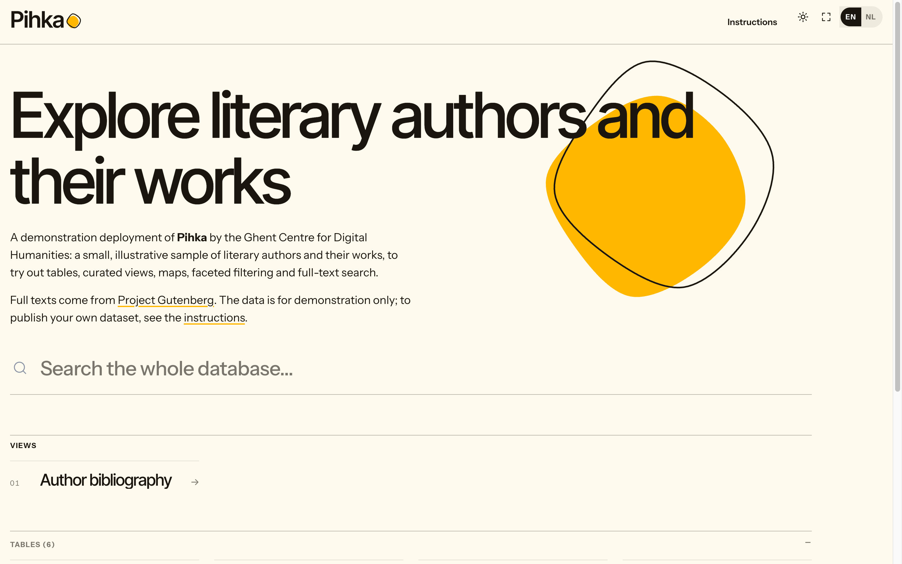
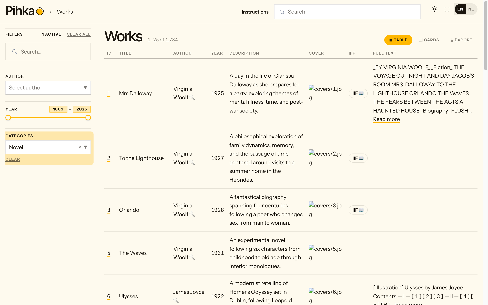
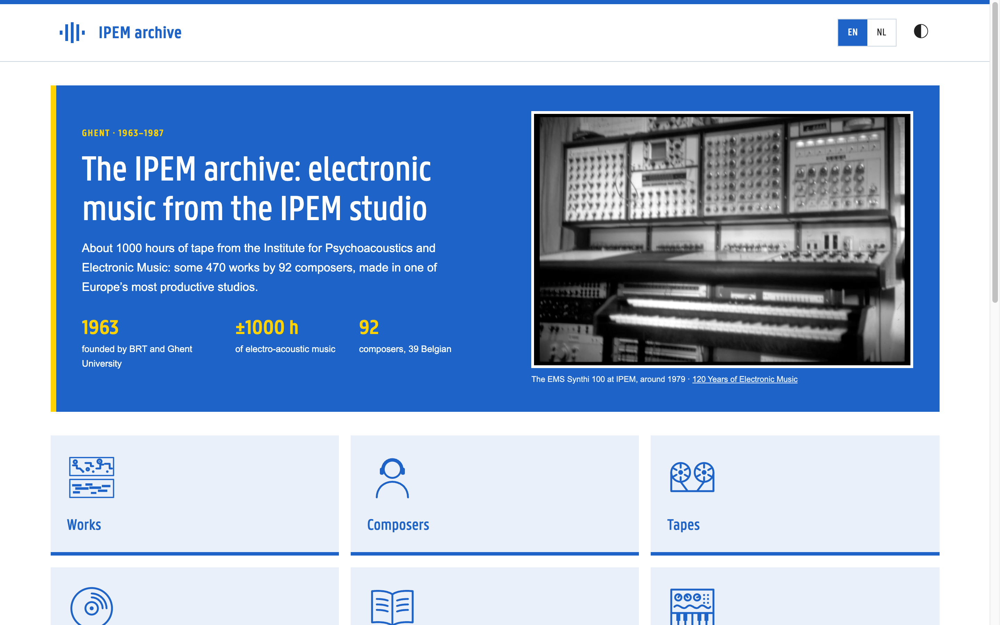
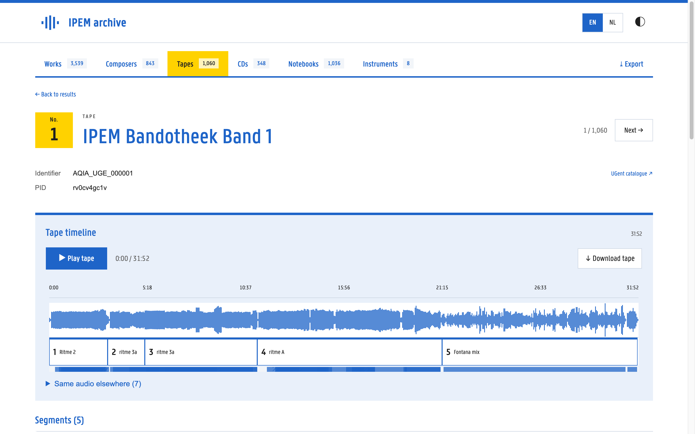
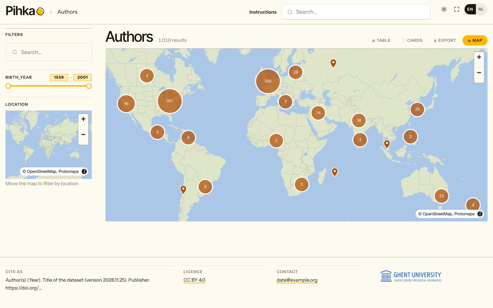
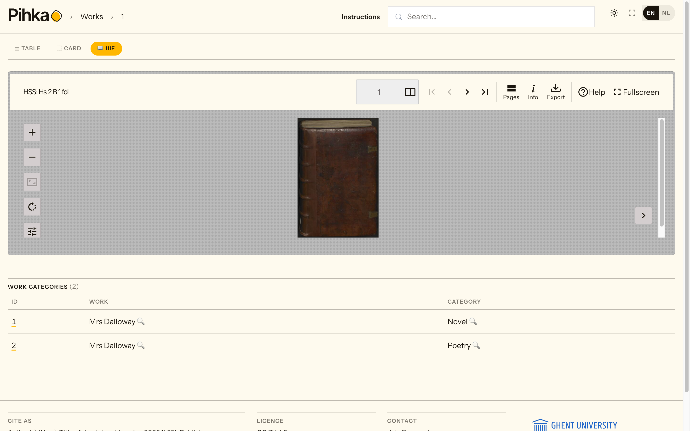
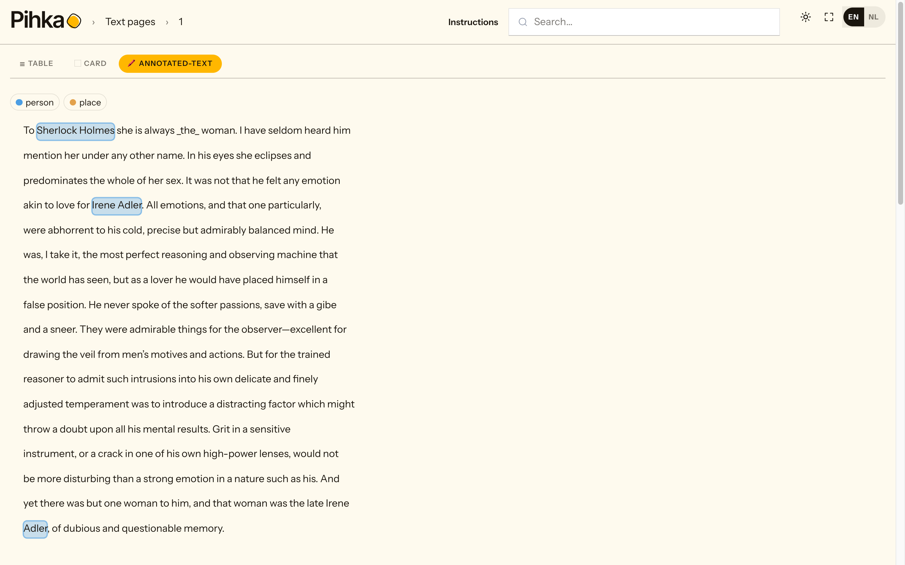

# Pihka - Sustainable data publication platform

## Abstract

## Introduction

The results of many digital humanities research projects are captured in a research database or data set. Researchers can spend years compiling lists of annotations, historical social networks, metadata on coin finds, and so forth. The main outcome of such research is the research data itself, together with the research questions that can be answered with that data.

The *afterlife* of research data can take several forms. Publishing a static dump on a research data platform already makes the data reusable and is good practice. Unfortunately, static data dumps are not very attractive. Browsing, filtering or searching through a static data dump is not straightforward. Getting a feel for the data is difficult, even with metadata documentation.

An alternative is to keep a software environment alive where data can be accessed, browsed and queried. The reality of hosting databases, back-ends, microservices, or other 'live' services is that there are *costs associated with maintenance*: upkeep, security upgrades, monitoring, and so on. These costs should be avoided, since the reality of project funding is that, once a project is completed, there is effectively no budget for maintenance. Keeping infrastructure with real running costs while having no budget is not sustainable. Over time, the result is a graveyard of DH projects and, even worse, inaccessible research data.

The reality of a *zero maintenance budget* should be an integral part of *the design of sustainable data publication software*. There is a need for a platform which goes beyond a static data dump and presents data in an attractive way, with the functionality expected from a data publishing platform: faceted search, full-text search, data exploration and extendable data visualisation, while keeping maintenance costs virtually zero. This paper presents a set of software design choices for a sustainable data publication platform, together with an open-source implementation in the form of the Pihka platform.

## Requirements and sustainable software

Some hallmarks of sustainable software systems in general are:

* Accessible documentation.
* Ease of deployment and migration.
* Only strategic dependencies on other software, and no dependencies on external services.
* Low cost to keep running: no back-end.
* Avoiding esoteric or experimental technologies which need specialised, rare expertise.

A different set of principles, described by the Endings project (principles 2.2.1), also serves as inspiration:

* **Data**: stored in open formats with verified integrity and accuracy over the life of the project.
* **Documentation**: clearly documented data models (field names, descriptions, controlled values) kept with the data as static documentation, alongside clear rights and intellectual property documentation (using open licences like Creative Commons, GNU, BSD, or MPL where possible).
* **Processing**: workflows and code are treated as contingent; they are not expected to have long-term longevity on their own, though they are aligned with the data and product principles where possible.
* **Products**: end-user outputs (such as websites or print documents) are built as static sites with no server-side software (no databases, PHP, or Python), no boutique technologies (relying on standards like HTML5, CSS, and JavaScript), no external library or service dependencies (such as jQuery, Bootstrap, or external search widgets), and no query strings (using simple URLs for each entity).
* **Release management**: structured versioning and archiving practices, so that static outputs remain citable and preserved.

Both sets of principles were taken into account while designing Pihka. We add SQLite to the list of technologies to use: it is an archival standard and has several open-source implementations in different programming languages. Pihka assumes a read-only setting focused on data publishing, data exploration and data description, with a database of limited size.

## Pihka software architecture

Pihka means resin in Finnish. The metaphor is that resin captures the data and allows it to survive far into the future. The Finnish name also refers to the inspiration for this project: Sampo-UI, a project which visualises DH data using SPARQL endpoints.

Pihka does not optimise for bandwidth but for ease of use, clarity and limited dependencies.

*Figure 1. The home page of the Pihka demo (https://ghentcdh.github.io/Pihka/).*

*Figure 2. A faceted list view in the Pihka demo, filtered on one category.*

### Core: JavaScript programming language

Browsers serve as a stable platform with a good track record of backwards compatibility.

Bundleless JavaScript: modern JavaScript libraries like React, Vue and Lit offer a great deal of functionality, but this comes at the cost of an explosion of dependencies on bundlers, ecosystems and tooling.

We make the radical choice of targeting plain JavaScript and a limited set of documented browser APIs, which avoids hard coupling to a browser rendering engine and its dependencies. The cost is, of course, that some functionality available in frameworks is duplicated and needs to be maintained by the project itself. Having a clear scope and focus should keep this duplicated functionality in check and protect Pihka against software erosion.

Examples of this approach are the browser-based image editor DPaint-js (<https://github.com/steffest/DPaint-js>) and the overview of modern bundleless JavaScript at <https://playfulprogramming.com/posts/modern-js-bundleless>.

Avoiding a build step also avoids deployment issues later on.

We explicitly avoid TypeScript, since additional tooling is needed to transpile TypeScript to JavaScript.

### Core: SQLite as relational database

SQLite is a format recommended for archiving by the Library of Congress (<https://www.loc.gov/preservation/resources/rfs/data.html>).

It is the most widely deployed database in the world.

Several independent implementations can read its file format, for example Turso, written in Rust.

### Core: Independent query engine and replaceable user interface

The implementation separates a browser-based query engine from presentation. A single `openDataset` entry point loads a datasource, discovers structural metadata, prepares or discovers search indexes and perspectives, and returns a query facade with explicit cleanup. Queries and filters use plain data; SQL and database handles remain inside the engine. Labels, visibility, formatting, routes, and widget choices belong to the user interface.

The default datasource downloads and deserialises a complete SQLite file. An optional HTTP VFS reads immutable published databases through HTTP ranges. The default prioritises simplicity; the optional source accommodates larger publications without making range support mandatory for every host. Both implementations share query contracts and are tested independently. The range source requires prebuilt indexes and views and never silently falls back to downloading.

The current UI uses vendored Preact without transpilation. Pihka's shell, pages, views, cells, and facets register through a UI component registry. Default core components use the same mechanism as optional extensions, including tables embedded in search results, related records, and map views. The Preact rendering and error boundaries reside in the UI runtime. If it is ever needed, replacing the framework entails replacing its runtime and renderers, while preserving the data engine and query contracts.

Engine and UI plugins have separate configuration lists and explicit registration functions. Registries belong to individual sessions, and a failed plugin installation does not leave partial registrations. This small set of boundaries avoids a general-purpose plugin framework while making the dependency graph testable. Architecture checks, real-browser tests for both datasources, and interactive checks verify the boundaries between the different Pihka layers and the user-facing behaviour.

The IPEM archive (<https://ipem-archive.ugent.be/>) shows what this separation allows: it presents an archive of electronic music recordings with its own user interface, including tape timelines with audio playback.

*Figure 3. The home page of the IPEM archive.*

*Figure 4. A tape record in the IPEM archive, with a timeline of its segments and audio playback.*

### Extendability

Pihka allows registering components that show detail views or list views for (filtered) data in many forms. Both core UI functionality and extensions are registered in a registry in the same way, so that core views can be overridden or new views can be added.

### Extension: Mapping without external services

DH projects often have a mapping component. Like the rest of Pihka, mapping works without external services or software running on a server. The implementation uses locally hosted PMTiles basemaps, with independently swappable assets for the map and location-filter extensions. A publication can provide a basemap suited to its region of interest without depending on a third-party tile service. A rough version of the world map (6 MB) is provided; if building-level deep zoom is needed, a 120 GB file can replace the 6 MB version.

There is no dependency on external mapping services, expiring API keys or rate limiting.

The maps are built on Protomaps (<https://protomaps.com/>) and the associated PMTiles technology for static map hosting (<https://docs.protomaps.com/pmtiles/>).

*Figure 5. The map extension in the Pihka demo, showing authors on a locally hosted PMTiles basemap.*

### Extension: IIIF viewer

IIIF is a standard way to describe and use images and their metadata on the web. With a rich ecosystem of viewers, tooling and annotation platforms, it has become the de facto standard to publish historic manuscripts and other scanned material.

A selling point of IIIF is that archives allow image infrastructure reuse and implicitly promise to keep IIIF endpoints running. The advantage is that heterogeneous data sets can be combined in a single endpoint and that storage, hosting and infrastructure are reused. However, relying on external archival partners to host IIIF is a concern and breaks the Pihka philosophy of keeping everything local. There are solutions to keep manifests and IIIF tiles completely static and local; see the IIIF training material for such a setup (<https://training.iiif.io/>).

In practice, Pihka includes the lightweight IIIF viewer TIFY (<https://tify.rocks/>). The extension does not rely on external code but keeps everything local.

*Figure 6. The IIIF extension: a record's manifest opened in the TIFY viewer.*

### Extension: Text annotation

Next to maps and images, annotations on text are another common type of data which requires a bespoke visualisation. Lists of where person names, place names or other entities occur in a text quickly become unwieldy if no custom visualisation is used.

In practice, the extension uses the `@ghentcdh/annotated-text` library (<https://www.npmjs.com/package/@ghentcdh/annotated-text>) to highlight annotated spans in the text.

*Figure 7. The text annotation extension, highlighting person and place annotations in a text.*

### Custom machine readable formats

Similar to views Pihka should allow to plug-in field related standard representations: xml formats, json formats, TEI documents, .. through the use of components which yield this info. 

### Bibliography 

*2018 Software sustainability: Research and practice from a software architecture viewpoint*
Colin C. Venters a, [Rafael Capilla b](https://www.sciencedirect.com/author/8931696900/rafael-capilla), Stefanie Betz c, [Birgit Penzenstadler d](https://www.sciencedirect.com/author/24765180000/birgit-penzenstadler), [Tom Crick e](https://www.sciencedirect.com/author/14032736300/tom-crick), Steve Crouch f, [Elisa Yumi Nakagawa g](https://www.sciencedirect.com/author/7007008701/elisa-yumi-nakagawa), Christoph Becker h, Carlos Carrillo i
@article{venters2018software,
  title={Software sustainability: Research and practice from a software architecture viewpoint},
  author={Venters, Colin C and Capilla, Rafael and Betz, Stefanie and Penzenstadler, Birgit and Crick, Tom and Crouch, Steve and Nakagawa, Elisa Yumi and Becker, Christoph and Carrillo, Carlos},
  journal={Journal of Systems and Software},
  volume={138},
  pages={174--188},
  year={2018},
  publisher={Elsevier}
}

Life and Death of DH Projects: A Preliminary Investigation of Their Lifecycles in Italy, Erica Andreose, Giorgia Crosilla, Remo Grillo , Gianmarco Spinaci
@incollection{andreose2025life,
  title={Life and Death of DH Projects: A Preliminary Investigation of Their Lifecycles in Italy},
  author={Andreose, Erica and Crosilla, Giorgia and Grillo, Remo and Spinaci, Gianmarco and others},
  booktitle={Diversit{\`a}, Equit{\`a} e Inclusione: Sfide e Opportunit{\`a} per l’Informatica Umanistica nell’Era dell’Intelligenza Artificiale, Proceedings del XIV Convegno Annuale AIUCD2025},
  pages={575--580},
  year={2025}
}

Endings Project
https://endings.uvic.ca/principles.html

2023 Sustainable software engineering: Reflections on advances in research and practice \nColin C. Venters a b , Rafael Capilla c g , Elisa Yumi Nakagawa d g , Stefanie Betz e g , Birgit Penzenstadler f g , Tom Crick h , Ian Brooks i
@article{venters2023sustainable,
  title={Sustainable software engineering: Reflections on advances in research and practice},
  author={Venters, Colin C and Capilla, Rafael and Nakagawa, Elisa Yumi and Betz, Stefanie and Penzenstadler, Birgit and Crick, Tom and Brooks, Ian},
  journal={Information and Software Technology},
  volume={164},
  pages={107316},
  year={2023},
  publisher={Elsevier}
}

digital humanities quarterly special issue intro text
@article{holmes2023introduction,
  title={Introduction to Special Issue: Project Resiliency in the Digital Humanities.},
  author={Holmes, Martin and Jenstad, Janelle and Huculak, J Matthew},
  journal={DHQ: Digital Humanities Quarterly},
  volume={17},
  number={1},
  year={2023}
}

Academics Retire and Servers Die: Adventures in the Hosting and Storage of Digital Humanities Projects
https://dhq.digitalhumanities.org/vol/17/1/000669/000669.html
@article{cummings2023academics,
  title={Academics Retire and Servers Die: Adventures in the Hosting and Storage of Digital Humanities Projects.},
  author={Cummings, James},
  journal={DHQ: Digital Humanities Quarterly},
  volume={17},
  number={1},
  year={2023}
}